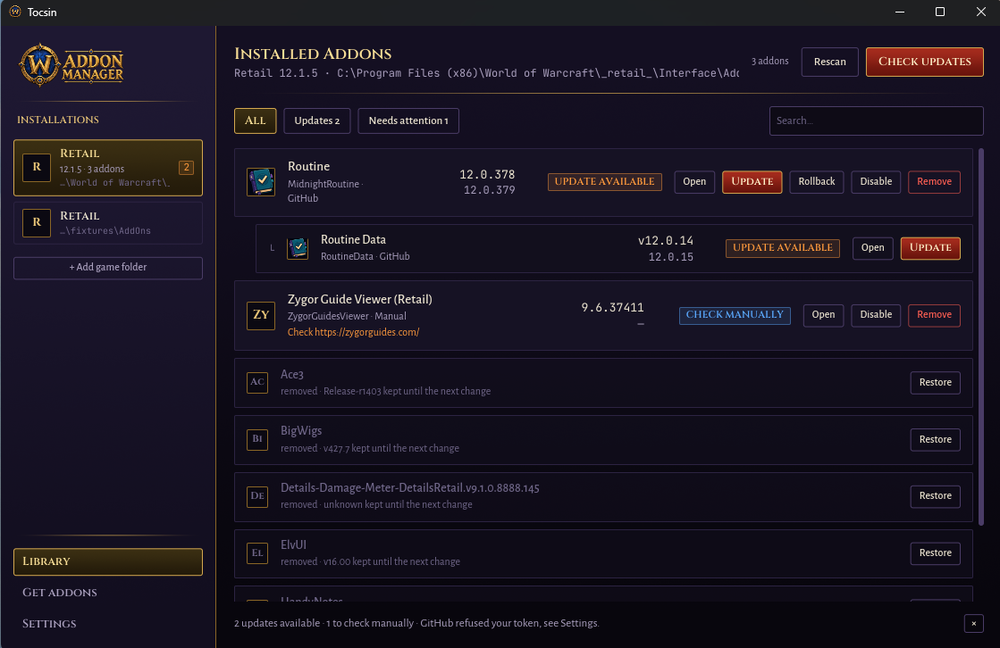

# Tocsin

Tocsin tells you when your World of Warcraft addons have a newer version out,
and updates them for you when it can. It reads the addons you already have
and asks the site each one came from: CurseForge, WoWInterface, GitHub or
Tukui.

It's one small Windows program. No account, no login, nothing left running in
the background. You open it, it looks at your AddOns folder, and it tells you
what's out of date.

> *tocsin*: an alarm bell. Also, it reads `.toc` files. Sorry.



## Why I made it

Two reasons, both selfish.

I wanted to learn Rust on something I'd actually use, and an addon checker is
about the right size: it reads some text files and talks to a few websites.

And I was tired of the big addon clients. They want to be *the* way you
install addons: a store, a login, a built-in browser, ads, an icon in the
tray that outlives the game. All I wanted was a window that looks at my
AddOns folder and says what's out of date.

So that's what Tocsin does. It reads what's already on disk and, when an
addon says where it's published, asks that site for the latest version. When
it can't tell, it says so and gives you the link, rather than pretending.

## How it works

Every addon comes with a small text file the game reads at login (the `.toc`).
Most of them also say where the addon is published: a CurseForge project, a
WoWInterface page, a GitHub link. Tocsin reads that, asks the site for the
latest version, and compares it with the one you have.

If the addon doesn't say, Tocsin looks for a link in its changelog or readme.
If there's simply no one to ask (addons sold on the author's own site, like
Zygor), it tells you to check by hand and gives you the link.

A zip a guildmate sent you is tracked only if the addon inside names a site
Tocsin knows. If it doesn't, you can point Tocsin at one yourself (see
*Overriding the guess* in [docs/technical.md](docs/technical.md)).

Addons that come in several folders, like *Deadly Boss Mods* and its modules,
are shown together as one entry so the list stays short.

Tocsin only ever touches your addon folders. Your settings, keybinds and
profiles (the `WTF` folder) are never modified.

## Getting started

1. Download the `.zip` from the [latest release](../../releases/latest) and
   unzip it wherever you like. There's nothing to install: `tocsin.exe` *is*
   the app, and deleting the folder removes it. The only things left behind
   are a small settings file under `%APPDATA%\tocsin`, a cache under
   `%LOCALAPPDATA%\tocsin`, your API keys in Credential Manager, and the
   `.tocsin-*` folders inside `AddOns`.
2. Run `tocsin.exe`. If Windows shows a blue "Windows protected your PC" window, click
   *More info*, then *Run anyway*. That's Windows being careful with a
   program from a small project that isn't signed (see
   [Why the releases aren't signed](#why-the-releases-arent-signed)).
   If your PC has **Smart App Control** turned on, Windows refuses to start
   it and offers no *Run anyway*. There's no way around that for an unsigned
   program, and switching Smart App Control off is a system-wide choice I
   wouldn't make just for Tocsin.
3. The first time, Tocsin asks for your game folder. Pick your World of
   Warcraft folder, or `_retail_` (or `_classic_era_`, `_classic_`,
   `_anniversary_`, `_ptr_`, …) inside it. The `Interface` or `AddOns` folder works
   too, as long as it sits inside the game: an `AddOns` folder anywhere else
   (another game's, a backup copy) is refused. If the game has never had
   addons, start it once (it creates `Interface\AddOns`), or create that
   folder yourself.

From then on you'll see every addon you have, the version you're on, and,
for the ones Tocsin can ask about, the newest one available.

### Checking the download (optional)

Every release is built by GitHub straight from the code in this repository,
never on someone's PC. If you want to be sure the zip you have is the one
that was published, open PowerShell in the folder where you saved it and run:

```powershell
Get-FileHash tocsin-*-windows-x64.zip
```

The long code it prints must match the one in `SHA256SUMS.txt` on the same
release page (PowerShell prints it in capitals, the file in lower case; only
the letters and digits matter). If it doesn't match, don't run it, and open
an issue.

If you use the [GitHub CLI](https://cli.github.com/), you can go one step
further and check that the file was built from this repository:

```powershell
gh attestation verify tocsin-v0.1.2-windows-x64.zip --repo giacomomicoli/tocsin
```

## Using it

### Reading the list

Each addon gets a badge:

| Badge | What it means |
|---|---|
| **Update available** | There's a newer version. |
| **Up to date** | You have the latest. |
| **Ahead of source** | You have something newer than the site shows (a test version, or the site is behind). |
| **Version unknown** | The site answered, but the addon doesn't say which version you have, so Tocsin can't compare. |
| **Check manually** | Tocsin can't ask anyone about this one. The link to check is shown under the name. |
| **No source** | Nothing in the addon says where it comes from. You can tell Tocsin (see *Something isn't right?*). |
| **Ignored** | You asked Tocsin to skip it. |
| **Missing** | Another addon needs this one, and you don't have it. *Install* fetches it. |
| **Error** | The site didn't answer, or it needs a CurseForge key (see below). |

A red note under a name means something looks wrong on disk, for example a
folder with the wrong name (it happens when you unzip a GitHub download as
it is). A grey "built for 12.1.0, game is 12.1.5" is the same *out of date*
warning the game shows, and is usually harmless.

### Updating, and going back

Press **Update** and Tocsin downloads the new version, checks it, and puts it
in place. The version you had is kept aside: if the new one breaks something,
**Rollback** puts the old one back (and you can change your mind again
afterwards).

You can update while the game is open. Type `/reload` in game and the new
version is loaded.

When a site doesn't offer a direct download, *Open* takes you to the page
instead.

### Turning addons off, or removing them

**Disable** moves an addon out of the game's way without deleting it;
**Enable** brings it back. It applies to the whole game folder, not to a
single character, and the addon disappears from the in-game list instead of
showing unticked.

**Remove** takes an addon away, but keeps a copy: it stays at the bottom of
the list with a **Restore** button until you change that addon again. Its
saved settings stay where they are, so reinstalling it later picks them back
up.

**Delete** gets rid of an addon for good. It is offered on a disabled addon
and on a removed one, and asks first: the files and the kept copy are
deleted and cannot be restored. Its saved settings stay, as with Remove.

### Getting new addons

**Get addons** searches CurseForge, WoWInterface, GitHub and Tukui at the same
time. An addon available on several sites shows up once, with one line per
site, so you can choose where to get it from. Each line shows how popular it
is and the year it was last updated, which is handy to spot an old copy
someone forgot on one of them.

Tocsin remembers where you installed an addon from and keeps checking there.
Addons you already have are marked *Installed*. Search runs when you press
Enter.

> [!NOTE]
> Some sites can't be installed from in Tocsin, and those lines say
> *Site only* instead of showing **Install**. Click the **?** next to it to
> see why. On CurseForge, some authors only allow downloads from the
> CurseForge website, and search shows this up front. A GitHub project may
> have no releases to download, and Tocsin only finds that out the first time
> you try. Either way, use *Open* and install it by hand, or pick another
> site if one is listed.

If an addon you're installing brings along folders you already have (shared
libraries like `Ace3`), Tocsin tells you which and asks before replacing
them.

### More than one game

Every game folder you add (Retail, Classic, …) appears in the sidebar; click
one to switch. In *Settings → Theme* you can choose between a dark look
(*Void*, the default) and a light one (*Sunwell*).

## CurseForge key (optional, but recommended)

GitHub, WoWInterface and Tukui answer anyone. CurseForge only answers people
who have a personal key. It's free and takes a couple of minutes:

1. Go to https://console.curseforge.com/ and sign in.
2. Open *API keys* and copy yours.
3. Paste it in Tocsin under **Settings → API keys**.

Without it, Tocsin still finds a good share of your addons through the other
sites. The ones it can't will say *API key needed*.

You can also add a GitHub token there. You don't need one, it just lets
Tocsin ask GitHub more often.

Keys are kept in Windows' own Credential Manager, never written to a file by
Tocsin, and are only sent to the site they belong to. If you prefer, set
`TOCSIN_CURSEFORGE_KEY` / `TOCSIN_GITHUB_TOKEN` in your environment instead;
those win.

## Privacy

- Tocsin has no account, no analytics, and no server of its own. It talks
  only to the addon sites listed above, and to their picture servers for the
  addon icons.
- When you search, it sends what you typed to GitHub and CurseForge
  (WoWInterface and Tukui are searched in lists Tocsin downloads, so they
  never see your query). When it checks for updates, it asks each site about
  the addons that come from it. If you added a CurseForge key, it also asks
  CurseForge for the logos of your CurseForge addons, which tells CurseForge
  which ones you have. Nothing else about you or your computer is sent.
- It writes only in your `AddOns` folder (the addons, plus three hidden
  folders for downloads in progress, previous versions and disabled addons),
  in its own settings file (`%APPDATA%\tocsin`) and cache
  (`%LOCALAPPDATA%\tocsin`), and your keys go to Windows' Credential Manager.
  It never writes into `WTF`.
- It never installs anything without you pressing a button.

The details, for those who want them, are in
[docs/technical.md](docs/technical.md).

## Something isn't right?

- **An addon is matched to the wrong source, or never updates.** You can tell
  Tocsin where to look, or to skip it. See *Overriding the guess* in
  [docs/technical.md](docs/technical.md).
- **I want to undo everything.** Previous versions live in
  `AddOns\.tocsin-backup\<Addon>@<version>\`, disabled addons in
  `AddOns\.tocsin-disabled\`. Moving an addon's folder from there back into
  `AddOns` restores it by hand (Tocsin's own *Restore* button for it won't
  work after that, which is expected).
- **Found a bug?** Open an issue. For a security problem, see
  [SECURITY.md](SECURITY.md).

## What's next

- Signed Windows releases, if an affordable way to sign them comes along.
- A preview of what changed before you update.
- Linux and macOS packages.

## A word on how it was written

Tocsin is my first Rust project, and most of the code was written with a lot
of help from AI coding tools. I'm a developer, but my low-level background
stops at basic C, so I didn't write this the way a Rust veteran would.

What I did do is supervise it, with security, performance and plain good
practice as the bar: I reviewed the design and the security model
([docs/technical.md](docs/technical.md)), the tests, and what the app reads
and writes on disk. Both crates forbid `unsafe` code, and every change has
to pass formatting, `clippy`, the tests on Windows and Linux, and
`cargo deny` (known vulnerabilities, licences, banned dependencies) before
it's merged.

That's the honest picture. If you know Rust better than I do and something
looks wrong, odd or unidiomatic, I'd be glad to hear it: open an issue or a
pull request.

## For developers

Tocsin is written in Rust. How to build it, how it decides where an addon
comes from, and its security model are in
[docs/technical.md](docs/technical.md). Issues and pull requests are welcome.

## Why the releases aren't signed

Windows trusts a program more when it carries a code signing certificate.
Those certificates cost money every year, and the free program for open
source projects I applied to turned Tocsin down, so for now the releases
are unsigned. That's why Windows warns you the first time, and why Smart App
Control blocks it.

What you get instead is a release you can check for yourself:

- Every release is built by GitHub from the public code in this repository,
  by the [release workflow](.github/workflows/release.yml), from a version
  tag. Nothing built on a personal computer is ever published.
- Each zip comes with its SHA-256 checksum and a GitHub build attestation
  that ties it to the exact commit it was built from (see
  [Checking the download](#checking-the-download-optional)).
- If you'd rather not run a downloaded program at all, you can build Tocsin
  yourself from the source (see [docs/technical.md](docs/technical.md)).

## License

MIT, see [LICENSE](LICENSE). The bundled fonts (Cinzel, Alegreya Sans,
JetBrains Mono, in `crates/tocsin/assets/fonts`) are under the SIL Open Font
License 1.1; their licence texts sit next to them. The release zip carries
the MIT licence next to `tocsin.exe`, and the font licences in its
`licenses` folder together with `THIRD-PARTY-LICENSES.html`, which lists
every open-source library inside Tocsin and its licence.

World of Warcraft is a trademark of Blizzard Entertainment. This project is
not affiliated with Blizzard, CurseForge, WoWInterface, Tukui or GitHub.
